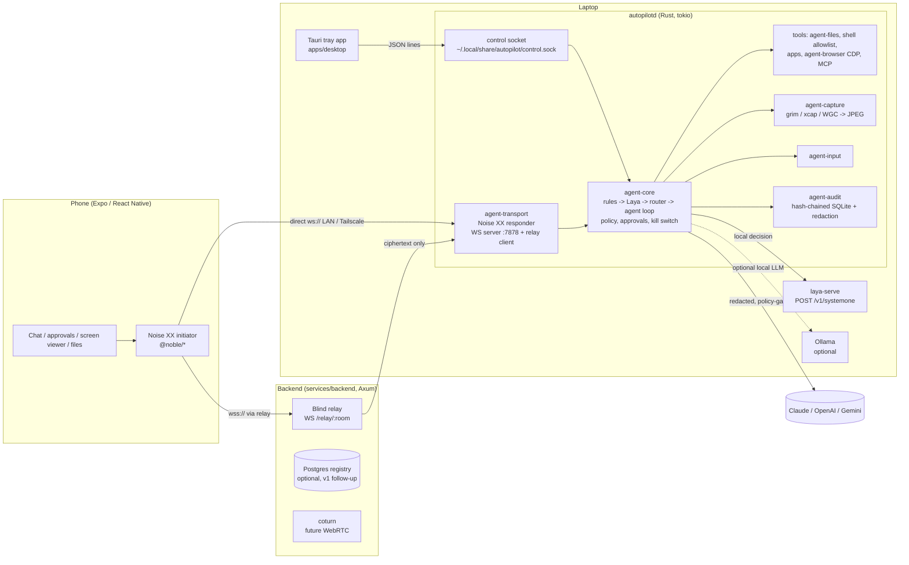

# Architecture

AutoPilot lets you drive your own laptop (Linux/Hyprland, Linux/X11, Windows) from your phone by
chatting with an agent that runs **on the laptop**. The phone is a thin, end-to-end encrypted remote;
the backend is a blind pipe. Wire format: [protocol.md](protocol.md). Security: [threat-model.md](threat-model.md).
Decisions: [decisions.md](decisions.md).

## Components

The relay only ever sees Noise handshake messages and Noise transport ciphertext. It never parses,
stores, or logs frame contents (see `services/backend/src/relay.rs`).

## Decision pipeline

Every user message goes through the cheapest stage that can handle it:

1. **Rules fast path** (`agent-core::rules`): deterministic parser for obvious commands
   ("volume 30", "lock screen", "screenshot", "open firefox"). Zero model calls, < 1 ms.
2. **Laya** (local decision model, `laya-serve`, `POST /v1/systemone`, Jev-compatible): returns a
   structured decision — intent, plan of tool calls, `route` (local | cloud), `cloud_reason`,
   `sensitivity`, `risk`, `confidence`. Laya is the *router*, not the general-purpose brain.
3. **Router / policy** (deterministic code has the final word):
   - `sensitivity=high` never leaves the laptop unless the user allowed that category;
   - cloud disabled or offline → stay local and say so;
   - low `confidence`, long generation, hard reasoning, or vision → cloud;
   - the chosen brain is reported per step in `task.update` (local / claude / openai / gemini).
4. **Cloud agent loop** (`agent-llm`): Claude, OpenAI, or Gemini behind one provider trait with
   tool calling. Input passes the redaction layer first. Loop capped at `max_agent_steps`.
5. **Tools** run through the registry: each tool declares its risk tier. `read` runs and logs;
   `write` and `destructive` send `approval.request` to the phone and wait (expiry = deny).
   Tool output (web pages, files, command output) goes back to the model as **untrusted data**;
   it can never raise its own privileges, and risk-tier approvals apply no matter who proposed the call.

The kill switch (phone `control.kill`, tray button, global hotkey, `autopilotd kill`, Hyprland bind)
cancels the running task, pending approvals, and any screen stream.

## Transport

- v1: Noise `XX_25519_ChaChaPoly_BLAKE2s` over WebSocket binary frames, behind a transport trait.
  Paths: direct (LAN/Tailscale, laptop listens on `:7878`) or relay (`/relay/<room>`).
- Relay rules: one laptop + one phone per room; phone joins only while the laptop is present
  (otherwise closed 4404 → phone retries with backoff); laptop gets text `peer-connected` before
  the phone's first frame; newer same-role connection replaces the older (4000); laptop leaving
  closes the phone (4410); frames > 70 000 bytes close (1009); 120 s idle (4408); per-IP rate limit.
- Later: WebRTC (data channel + video track) via coturn, same Noise layer inside (ADR-002).

## Battery, latency, and CPU strategy

| Where | Strategy |
| --- | --- |
| Daemon | Fully event-driven tokio: sockets, control socket, and timers only. **No polling loops.** Idle CPU ≈ 0. |
| Laya | Started on demand; **unloaded after 5 min idle** (frees RAM/VRAM, no background inference). |
| Ollama (optional) | Requests set `keep_alive` (e.g. `5m`) so the model stays warm during a conversation and unloads afterwards. |
| Decision path | Rules fast path first; Laya next; cloud only when the router says so. Most commands never touch a network LLM. |
| Screen | **Only on demand** (`screen.request` snapshot/start) or at policy stages. No continuous capture. |
| Capture (Hyprland) | `grim -t jpeg -q 60` straight from the compositor (wlr-screencopy) — no portal round-trip, no video encoder, JPEG ready to send. X11/Windows: xcap → `image` JPEG. |
| Streaming | 2 fps default (cap 15), 1280 px wide, quality 60; frames split into ≤ 64 KB `screen.frame` parts. Stop on `stop`, kill, or session loss. |
| Phone | Closes the socket when the app goes to background; reconnect + fresh handshake on foreground (handshake is 1.5 RTT). Ping every 25 s only while foregrounded. |
| Relay | Pure byte pipe: no parsing, bounded per-connection queues, backpressure instead of buffering. |

Latency targets: rules path < 50 ms end-to-end on LAN; Laya decision < 300 ms warm; snapshot
(grim + send) < 250 ms on LAN.

## Platform notes

- **Hyprland/Wayland (first-class):** capture via `grim`, input via `wtype`/`ydotool` or
  virtual-keyboard/pointer protocols, window control via `hyprctl` (in the shell allowlist).
  A Hyprland keybind can call `autopilotd kill` (see [runbook.md](runbook.md)).
- **X11:** xcap + XTest (enigo).
- **Windows:** Windows Graphics Capture (xcap) + SendInput (enigo). UAC secure desktop is not controllable.

## Data on the laptop

`~/.local/share/autopilot/` (Linux) holds device keys (0600), trust store, audit DB, control socket,
and the Laya venv (`laya-venv/`). API keys live in the OS keystore (`autopilotd keys set <provider>`).
